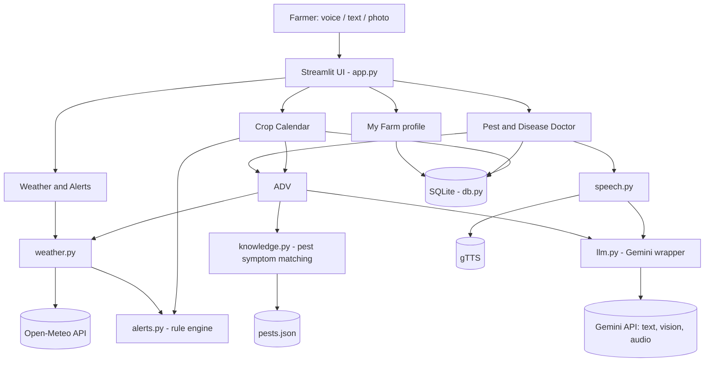

# KisanMitra: A Multilingual AI Farmer Helper (Crop Advice, Weather Alerts and Pest Doctor with Voice)

> **Purpose of this README:** it is a complete description of the project (problem, features, architecture, tech stack, algorithms, thresholds, data, database, UI, testing, limitations). It is written so that someone (or another AI assistant) can prepare the **project report** and the **PPT** from this file alone, without seeing the code.

---

## 0. Quick facts (for the report cover page and abstract)

| Item | Value |
|---|---|
| Project title | **KisanMitra: A Multilingual (Tamil, Hindi, English) AI Assistant for Farmers with Voice Input, Weather-Based Farm Alerts, Crop Stage Planning and Pest/Disease Diagnosis** |
| Short name | KisanMitra ("Kisan" = farmer, "Mitra" = friend) |
| Subject | AI Engineer Internship (2 credits), Semester VII |
| Student | Rakshana Fathima M, Register No. 230071603001 |
| Programme | B.Tech, batch 2023-2027, B.S. Abdur Rahman Crescent Institute of Science and Technology |
| Type | Mobile-friendly Streamlit web application |
| Language | Python 3.10+ |
| UI framework | Streamlit |
| AI model | Google Gemini (default `gemini-2.5-flash`) via the `google-genai` SDK: text, JSON, vision (photos), audio transcription |
| Weather | Open-Meteo free API (no key needed) |
| Voice | Speech-to-text: Gemini audio understanding. Text-to-speech: gTTS |
| Database | SQLite (auto-created `data/kisanmitra.db`) |
| Languages supported | English, Tamil (தமிழ்), Hindi (हिन्दी) |
| Lines of code | about 1,150 (Python) |
| Run command | `streamlit run app.py` |

---

## 1. Problem statement

Small and marginal farmers in India face four practical problems:

1. **Language barrier**: most agriculture apps and websites are in English, while farmers think and speak in Tamil, Hindi and other regional languages.
2. **Voice input**: farmers can describe crop symptoms by speaking instead of typing.
3. **Weather risk**: farmers need *actions* ("do not spray tomorrow, heavy rain is coming"), not raw numbers like "28 mm precipitation".
4. **Late pest and disease identification**: by the time an expert is reached, the damage has spread.

Farmers need a simple multilingual tool that combines their farm profile, local weather, crop-stage planning and cautious pest/disease guidance.

**KisanMitra** is one voice-enabled, three-language application that gives crop advice, weather-based alerts and photo-based pest/disease help, grounded in a built-in agriculture knowledge base with safety rules.

## 2. Objectives

1. Provide a multilingual interface in English, Tamil and Hindi, including voice input for pest descriptions.
2. Fetch the **7-day weather forecast** for the farmer's own village/town and convert it into **plain-language farm alerts** (spraying, irrigation, heat, cold, wind, fungal risk).
3. Diagnose **pest/disease problems from a leaf photo** and/or a text description, with organic steps first and a safe note on chemicals.
4. Provide a **crop calendar**: given the crop and sowing date, show the current growth stage, tasks for that stage, expected harvest date and a timeline.
5. Keep working (in a reduced mode) even when the AI key or the internet is unavailable.

---

## 3. Unique selling points (what makes it different from a general chatbot)

| # | Feature | Why a general chatbot does not match it |
|---|---|---|
| 1 | **Three languages, end to end**: localized interface, voice input for pest symptoms and diagnosis read-aloud; the whole UI, navigation and weather alerts are also in Tamil/Hindi | General chatbots answer in English unless prompted each time and do not give a complete localized farm UI |
| 2 | **Personal farm profile**: location, land, soil, crops with sowing dates are stored; farm tools use them | A general chatbot has no persistent farm context |
| 3 | **Weather to action alerts**: a rule engine converts raw forecast numbers into farm instructions in 3 languages (works even without AI) | General chatbots do not fetch live local weather or give deterministic, explainable alerts |
| 4 | **Crop-stage-aware planning**: days after sowing gives the current stage and tasks for 10 crops, merged with weather alerts | No stage tracking in general chatbots |
| 5 | **Pest symptom matching**: TF-IDF narrows symptom descriptions to likely entries in the built-in pest database | General chatbots answer from model memory |
| 6 | **Pest doctor with candidate narrowing**: TF-IDF narrows to candidate pests from a 23-entry database, then Gemini vision looks at the photo and decides among them | Reduces random diagnoses; always shows other possibilities |
| 7 | **Safety by design**: the AI is instructed never to invent pesticide names or doses; chemicals always say "ask the agriculture officer and follow the label"; organic steps first; Kisan Call Centre number shown | General chatbots may give unsafe doses |
| 8 | **Graceful offline mode**: rule-based alerts, crop calendar and text-based pest matching work without the AI key | Chatbots are unusable offline |

---

## 4. System architecture



**Layers:** (1) Presentation: Streamlit with 5 pages and a language switcher. (2) Application: modules in `core/`. (3) AI layer: `core/llm.py` (all Gemini calls, with offline fallbacks). (4) Data layer: JSON knowledge bases (read-only), SQLite (farmer data) and two external APIs (Open-Meteo, Gemini) plus gTTS.

---

## 5. Tech stack (with reasons)

| Layer | Technology | Purpose / reason |
|---|---|---|
| Language | Python 3.10+ | Standard for AI |
| Web UI | **Streamlit** (>=1.55) | Pure-Python web app; built-in microphone widget `st.audio_input`, camera widget `st.camera_input`, file upload; mobile friendly |
| LLM | **Google Gemini** `gemini-2.5-flash` via **`google-genai`** | Free tier, multilingual (Tamil, Hindi), **vision** for leaf photos, **audio understanding** for speech-to-text, JSON output mode |
| Pest matching | **scikit-learn** `TfidfVectorizer` + cosine similarity | Lightweight, offline symptom matching against the pest database |
| Weather | **Open-Meteo** Forecast API + Geocoding API (via `requests`) | Free, no API key, gives daily rain, rain probability, temperature, wind and evapotranspiration |
| Speech-to-text | Gemini audio input (WAV bytes) | One service handles Tamil/Hindi/English speech |
| Text-to-speech | **gTTS** (`ta`, `hi`, `en`) | Free Google TTS, supports Tamil and Hindi |
| Database | **SQLite** (`sqlite3`) | Zero-config storage of farmer profile, crops and history |
| Charts | **Plotly** | Forecast chart (temperature lines + rain bars) and crop timeline |
| Data handling | pandas | Tables |
| Config | python-dotenv | Loads `GEMINI_API_KEY` from `.env` |
| Testing | Streamlit `AppTest` | Headless end-to-end test |

---

## 6. Project structure

```
kisanmitra/
|-- app.py                      # Streamlit UI: sidebar (language, nav, API key) + 5 pages
|-- requirements.txt
|-- .env.example                # template for the Gemini API key
|-- .streamlit/config.toml      # green theme
|-- README.md                   # this file
|-- core/
|   |-- config.py               # languages, TTS codes, alert thresholds
|   |-- i18n.py                 # all UI text, soil names and weather-alert templates in en/ta/hi
|   |-- llm.py                  # Gemini wrapper: ask_json (+vision), transcribe_audio, translate
|   |-- db.py                   # SQLite schema and queries
|   |-- knowledge.py            # loads knowledge bases, pest matching, crop stage logic
|   |-- weather.py              # Open-Meteo geocoding + forecast, sample forecast fallback, summary text
|   |-- alerts.py               # rule-based farm alert engine
|   |-- advisor.py              # pest diagnosis, diagnose (pest doctor), weekly_plan
|   `-- speech.py               # transcription and text-to-speech
|-- data/
|   |-- crops.json              # 10 crops: names (en/ta/hi), season, months, duration, water, soil, tips, 4 stages with tasks
|   |-- pests.json              # 23 pests / diseases / deficiencies with symptoms, cause, organic steps, safe chemical note
|   |-- practices.json          # 14 general practices (safe pesticide use, NSKE, soil testing, irrigation, storage, helplines)
|   `-- cities.json             # 33 Indian cities with coordinates (offline location fallback)
`-- tests/smoke_test.py         # unit tests + headless UI test (offline)
```

---

## 7. Setup and run

```bash
python -m venv venv
venv\Scripts\activate            # Windows   |   source venv/bin/activate  (Mac/Linux)
pip install -r requirements.txt
copy .env.example .env           # Windows   |   cp .env.example .env
#   edit .env and set GEMINI_API_KEY=your_key   (free key: https://aistudio.google.com/apikey)
streamlit run app.py
```

The browser opens at `http://localhost:8501`. The key can also be pasted in the sidebar. Without a key the app runs in **offline mode** (see section 12). Optional variables: `GEMINI_MODEL`, `KISAN_DB` (custom DB path), `KISAN_MOCK=1` (force offline mode; used by tests). Voice features need a browser with microphone permission and internet.

---

## 8. Pages and detailed behaviour

### 8.1 Sidebar (on every page)
- **Language selector**: English / தமிழ் / हिन्दी. Everything on screen (labels, buttons, alerts, crop names, soil names, sources) switches language.
- **Navigation**: My Farm, Weather & Alerts, Pest & Disease Doctor, Crop Calendar.
- **Gemini API key box** and an AI online/offline indicator.

### 8.2 My Farm (profile)
1. Enter a name and press "Open / create my farm" (no password; a simple local profile).
2. **Location**: type a village/town/city, press Find location. The Open-Meteo Geocoding API returns up to 5 matches (name, state, latitude, longitude); if the API is unreachable, a built-in table of 33 Indian cities is searched. The farmer selects the correct match and saves it (latitude and longitude are stored).
3. **Land (acres) and soil type** (red, black, alluvial, sandy, clay, loamy, not sure; labels in 3 languages).
4. **My crops**: choose a crop (10 available), sowing date and area, press Add crop. Each saved crop shows "days after sowing" and can be removed.

### 8.3 Voice input for Pest & Disease Doctor

The microphone input is used on the Pest & Disease Doctor page to capture a farmer's symptom description. Gemini transcribes the audio when AI is available; the transcript is combined with any typed symptoms before diagnosis. Text-to-speech can read the diagnosis aloud.

### 8.4 Weather & Alerts
1. Uses the saved latitude/longitude to fetch the Open-Meteo forecast (7 days).
2. Shows current temperature and humidity, the **alert cards** (red = high, orange = medium, green = info), a combined chart (max and min temperature lines + rain bars) and a table (date, max/min temperature, rain mm, rain probability, wind).
3. If the live API cannot be reached, deterministic **sample data** is shown with a clear warning banner (so the demo never breaks).

### 8.5 Pest & Disease Doctor
1. Inputs: crop (optional), photo upload or camera photo, text description, optional voice description.
2. **Candidate narrowing**: TF-IDF over the symptoms of 23 database entries gives the top 4 candidates (matches for the chosen crop are boosted x1.6, others reduced x0.3).
3. **With AI**: Gemini (vision if a photo exists) receives the photo, the description and the candidate list and returns JSON: likely issue, confidence (low/medium/high), what is seen, cause, organic steps, chemical note, prevention, and when to see an expert, all in the selected language.
4. **Without AI**: the top database candidate is shown (English) with its stored organic steps and a safe chemical note, and the user is told that photo diagnosis needs the AI key.
5. A permanent warning asks the farmer to confirm with the local agriculture officer or KVK before spraying chemicals and shows the Kisan Call Centre number (1800-180-1551). A Listen button reads the result aloud. "Other possibilities" are listed.

### 8.6 Crop Calendar
1. Pick one of the saved crops or any crop and sowing date.
2. `days_after_sowing = today - sowing_date`; the crop's 4 growth stages (each with start day, end day and 3 tasks) give the **current stage**, **tasks for this stage**, days until the next stage and the **expected harvest date** (sowing date + typical duration).
3. Weather alerts for the farmer's location are shown with the tasks; tasks and stage names are translated by Gemini when the language is Tamil/Hindi (English is shown when AI is offline).
4. A Plotly **timeline** of all stages with a dashed line for today; crop tips; **download the plan as a text file**.
5. "What can I sow this month?" lists crops whose typical sowing months include the current month, with a note that local season and variety matter.

---

## 9. Algorithms and rules (exact values in the code)

### 9.1 Farm alert engine (`core/alerts.py`, thresholds in `core/config.py`)
The alerts are **deterministic rules** (no AI), so they are explainable and work offline. Messages exist as templates in English, Tamil and Hindi (`core/i18n.py`).

| Alert | Rule | Severity | Advice given |
|---|---|---|---|
| Heavy rain | In the next 4 days: daily rain >= 20 mm, or rain probability >= 70% and rain >= 10 mm | High | Do not spray or apply fertiliser; keep drainage open |
| Heat | In the next 5 days: max temperature >= 38 C | High | Irrigate early morning/evening, use mulch |
| Cold | In the next 5 days: min temperature <= 8 C | Medium | Protect nurseries and young plants |
| Strong wind | In the next 5 days: wind >= 30 km/h | Medium | Support tall crops such as banana; do not spray |
| Dry spell | Rain total of next 5 days < 2 mm and mean evapotranspiration (ET0) >= 4 mm/day | Medium | Plan irrigation; avoid stress at flowering |
| Fungal risk | Current humidity >= 85% and at least 2 of the next 3 days have >= 2 mm rain | Medium | Inspect leaves daily; ask officer about prevention |
| Best spray day | First day in the next 5 days with rain probability <= 20% and wind <= 15 km/h | Info | Spray on that day |

### 9.2 Pest symptom matching (`core/knowledge.py`)
- TF-IDF compares symptom descriptions with pest/disease names, symptoms and causes.
- Matches affecting the selected crop (or all crops) are boosted; unrelated matches are down-weighted.
- The top matching candidates are passed to the diagnosis flow.

### 9.3 Crop stage logic
`das = days since sowing`. If das < 0: not sown yet. If das > crop duration: past expected harvest (warning). Otherwise the stage whose [start, end) range contains das. Example: rice at 30 days after sowing = "Tillering". Typical durations (days): rice 120, wheat 120, maize 100, cotton 160, groundnut 105, tomato 120, chilli 150, sugarcane 360, banana 360, ragi 110.

### 9.4 Prompt-engineering design (`core/advisor.py`)
- **System prompt rules:** reply in the requested language in short simple sentences; use the supplied KNOWLEDGE for specifics; if not covered, give only safe general advice and say you are unsure; organic and low-cost first; never invent pesticide names or doses; numbered steps; mention the Kisan Call Centre for serious problems; under 180 words.
- **Structured output:** the pest doctor requests JSON with fixed keys (values in the farmer's language, keys in English) and low temperature (0.2); JSON is parsed robustly (strips code fences, regex fallback).
- **Diagnosis context:** the selected crop, symptom description, optional image and candidate pest entries are placed in the diagnosis prompt.

### 9.5 Language handling
- **Static localization (no AI):** all UI labels, alerts, soil names and crop names are stored in three languages, so the interface is reliable and instant.
- **AI localization:** pest diagnosis text and (for the crop calendar) stage names/tasks/tips are produced or translated by Gemini in the selected language, with an in-memory translation cache.
- **Speech:** the language hint helps Gemini transcribe Tamil/Hindi/English symptom descriptions; gTTS codes `ta`, `hi`, `en` read diagnosis results (markdown symbols removed, max 1,500 characters).

---

## 10. Safety and responsible-AI measures
1. The model is told never to invent pesticide names or doses; chemical advice is always "ask your agriculture officer/KVK and follow the label dose and safety period".
2. Organic and cultural controls come first (neem seed kernel extract 5%, neem oil 3-5 ml/litre, sticky and pheromone traps, Trichoderma/Pseudomonas, removal of infected plants).
3. A general pesticide-safety practice chunk (mask, gloves, no spraying in wind or before rain, safety period) is in the knowledge base.
4. Every diagnosis shows its confidence, other possibilities, "see an expert if" and the Kisan Call Centre number.
5. Photo diagnosis is presented as decision support, not a replacement for an expert.

---

## 11. Data

- `crops.json` (10 crops): rice, wheat, maize, cotton, groundnut, tomato, chilli, sugarcane, banana, ragi. Each has English/Tamil/Hindi names, season, typical sowing months, duration, water need, soil, 3 tips and 4 stages with 3 tasks each.
- `pests.json` (23 entries): rice blast, brown planthopper, stem borer, bacterial leaf blight, zinc deficiency, wheat yellow rust, fall armyworm, pink bollworm, whitefly, aphids, early blight, late blight, leaf curl virus, fruit borer, thrips and mites, groundnut leaf spot, sugarcane red rot, sugarcane shoot borer, banana Panama wilt, banana bunchy top, nitrogen deficiency, powdery mildew, ragi blast. Each has crops affected, symptoms, cause, organic steps, a safe chemical note and prevention.
- `practices.json` (14): safe pesticide use, best time to spray, IPM, neem extract, soil testing/Soil Health Card, organic manures, saving water, seed treatment, crop rotation, grain storage, heavy rain, heat stress, where to get expert help (Kisan Call Centre, KVK), weed management.
- `cities.json` (33 Indian cities) for the offline location fallback.
- **Important:** this content is general guidance compiled from commonly published good agricultural practices, **not** a replacement for the advice of the local agriculture department; sowing months and stage timings vary by region and variety.

## 12. Offline / degraded modes

| Situation | What still works |
|---|---|
| No Gemini key | all weather alerts (3 languages), crop calendar (stage names/tasks in English), text-based pest matching, farm profile, charts |
| No internet | Same as above with sample weather (clearly labelled) and built-in city table for location |
| Open-Meteo down | Sample forecast with a warning banner |
| gTTS unavailable | Diagnosis text is still shown; a message explains that voice output needs internet |

## 13. Database schema (SQLite)

| Table | Columns |
|---|---|
| `farmers` | name (PK), language, location_name, state, lat, lon, land_acres, soil, created |
| `sowings` | id, farmer, crop, sow_date, area_acres |
| `history` | id, farmer, ts, kind (pest; older ask records may remain), language, question, answer |

## 14. Testing and validation

`python tests/smoke_test.py` (offline, no key or internet needed) runs:
- **Unit tests:** crop stage logic (including not-sown and past-harvest cases); alert engine produces heavy-rain, wind and spray-window alerts on the sample forecast and a heat alert when temperature is raised; alerts render in all 3 languages; text-based pest matching returns a diagnosis.
- **Headless UI test:** boot, create a farmer, search a location (built-in fallback), save it, add a crop, open the weather page, run a pest diagnosis, open the crop calendar, then switch the interface to Tamil and Hindi and visit every page. Result: **ALL SMOKE TESTS PASSED**.

**Honest testing note for the report:** the build environment had no internet access to Gemini, Open-Meteo or gTTS. The AI-dependent paths (photo diagnosis, pest voice transcription and translation), live weather and text-to-speech were therefore verified through their offline fallbacks and code review, not against the live services. All external calls are isolated in `core/llm.py`, `core/weather.py` and `core/speech.py`. The student should run the full demo once with a real key and internet before the presentation.

## 15. Demo script (about 5 minutes)

1. Choose **தமிழ்** in the sidebar; show that the whole UI changed.
2. **My Farm**: name, search "Coimbatore" (or the student's own town), save; add Rice sown 30 days ago and Tomato.
4. **Weather & Alerts**: show the forecast chart and alerts (e.g. best spray day, heavy rain warning).
5. **Pest & Disease Doctor**: upload a leaf photo (a tomato leaf with spots or curling), show diagnosis, organic steps, safety note.
6. **Crop Calendar**: choose Rice; show current stage, tasks, timeline, download the plan.
7. Switch to Hindi or English and show the localized interface and diagnosis flow.
8. Mention offline mode and safety design.

## 16. Limitations (state honestly in the report)
1. Knowledge base is small (10 crops, 23 pests); crops and conditions outside it rely on general model knowledge with cautious wording.
2. Photo diagnosis can be wrong, especially with poor photos or similar-looking symptoms; it is decision support only.
3. TF-IDF matches words, not meaning; unusual symptom wording may produce weak pest matches.
4. Sowing months and stage durations are typical values and vary by region, variety and season.
5. Weather accuracy depends on Open-Meteo's model forecast (grid-level, not field-level).
6. Voice quality depends on the microphone and noise; Tamil/Hindi dialects may be transcribed imperfectly.
7. Tasks and stage names in Tamil/Hindi are machine-translated by Gemini, not human-verified.
8. Profiles have no password; data is stored locally in one SQLite file.
9. Requires internet for AI, live weather and voice output.

## 17. Future scope
- Mobile app / WhatsApp bot and more regional languages (Telugu, Kannada, Malayalam, Marathi).
- Larger, expert-verified knowledge base and neural embeddings with a vector database.
- Mandi (market) price integration and government scheme eligibility (PM-KISAN, crop insurance) module.
- Soil Health Card OCR, satellite/NDVI crop-health monitoring, drip-irrigation scheduling from ET0.
- Offline on-device speech recognition for low-connectivity villages; SMS alerts.
- Fine-tuned plant-disease image model trained on datasets such as PlantVillage.

---

## 18. Guide for preparing the project REPORT from this README

**Suggested chapters (about 25-30 pages):**
1. **Introduction:** background (Indian agriculture, language and information gap), motivation, problem statement (section 1), objectives (section 2), scope.
2. **Literature survey / existing systems:** Kisan Call Centre, Kisan Suvidha, Plantix-type apps, general chatbots; build a comparison table using section 3.
3. **System analysis:** functional and non-functional requirements (usability for farmers, multilingual, offline fallback, safety), feasibility, hardware/software requirements (any laptop or phone browser, Python 3.10+, internet for AI and weather).
4. **System design:** architecture diagram (section 4), module diagram, data-flow diagrams for the three pipelines (farm profile; weather alerts; pest diagnosis; crop calendar), ER diagram from section 13, use-case diagram (actor: farmer).
5. **Implementation:** tech stack (section 5), page-wise description (section 8), algorithms and thresholds (section 9: alert rules table, pest matching, stage logic, prompt design), safety measures (section 10), data (section 11).
6. **Testing and results:** test-case table (location search, profile save, alert rules, stage logic, pest matching, language switching, offline modes), smoke test outcome (section 14), screenshots of all 4 pages in 3 languages.
7. **Conclusion, limitations (section 16) and future scope (section 17).**
8. **References:** Open-Meteo API docs, Google Gemini API docs, Streamlit docs, scikit-learn TF-IDF docs, gTTS, ICAR/TNAU/state agriculture university crop guides, Kisan Call Centre (Government of India), plus 3-5 papers on plant disease detection and agricultural chatbots.

**Figures/tables to include:** architecture diagram, alert-rule table (9.1), pest symptom-matching diagram, crop-stage table for any 2 crops, DB tables, screenshots (Tamil home page, voice symptom input, weather alerts chart, pest diagnosis, crop timeline), sample test-case table (ID, module, input, expected, actual, status).

## 19. Guide for preparing the PPT (suggested 12 slides)
1. Title (project name, student details, institution, subject)
2. Problem: farmer's 4 problems (language, typing, weather risk, late diagnosis)
3. Objectives
4. Why not a general chatbot? (USP table, section 3)
5. Architecture diagram
6. Tech stack
7. Voice input for pest diagnosis (Gemini transcription + pest matching)
8. Weather to action alerts (rule table)
9. Pest & disease doctor (photo + candidates + safety)
10. Crop calendar and stage tasks (timeline screenshot)
11. Results, testing, limitations
12. Conclusion, future scope, thank you / Q&A

## 20. Likely viva questions (short answers)
- **Why Gemini?** Free tier, strong Tamil/Hindi, vision for photos, audio understanding for speech, JSON mode.
- **Why TF-IDF and not embeddings?** Lightweight, offline, deterministic, enough for a small curated base; the custom tokenizer makes it work with Tamil/Hindi. Embeddings are future scope.
- **How do you avoid wrong or unsafe advice?** Grounded prompt, no invented chemicals or doses, organic first, confidence and expert note, Kisan Call Centre number.
- **How are weather alerts made?** Deterministic rules on Open-Meteo forecast numbers (section 9.1), so they are explainable and work without AI.
- **How does the voice feature work?** Browser microphone to WAV to Gemini transcription (with language hint); diagnosis text can be read aloud with gTTS.
- **What if there is no internet or API key?** Offline mode (section 12).
- **How do you know the crop stage?** Days after sowing mapped to stage ranges stored per crop.
- **What are the limitations?** Section 16.
- **What would you improve?** Section 17.